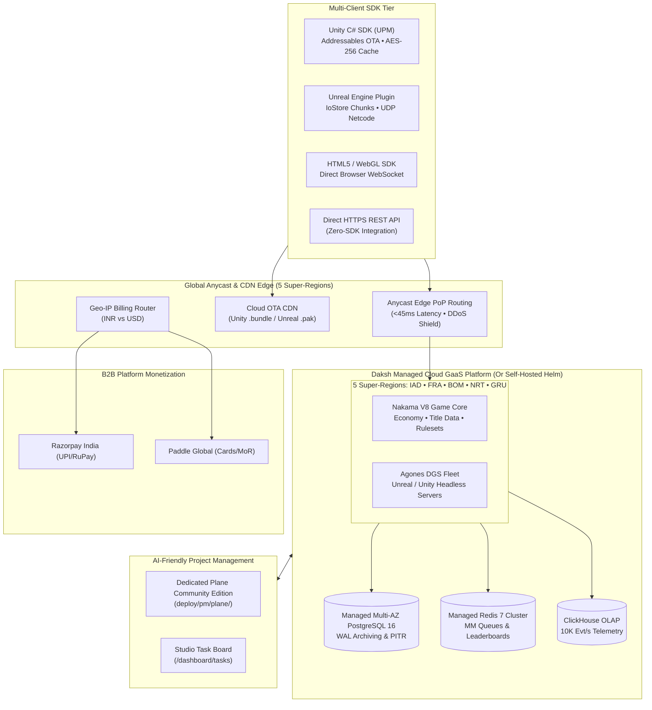

# Daksh — Generic Open-Source Game Backend-as-a-Service (BaaS) & Managed Cloud GaaS

<div align="center">

[](https://opensource.org/licenses/Apache-2.0)
[](https://github.com/ingeniidigital-hue/daksh/releases)
[]()
[]()
[]()
[](http://localhost:1337)

**A production-grade, open-source Game BaaS and fully managed Game-as-a-Service (GaaS) platform.**  
*PlayFab parity on an open-source Nakama, Agones, PostgreSQL 16 & Redis 7 foundation with zero vendor lock-in.*

[Quickstart](#quickstart) • [Architecture](#system-architecture) • [Feature Pillars](#core-feature-pillars) • [Project Management (Planka)](#dedicated-open-source-project-management-planka) • [Multi-Client SDKs](#multi-client-sdk-suite) • [Branching & Releases](#branching--release-governance) • [License](#license)

</div>

---

## Overview

**Daksh** provides high-throughput game backend primitives without locking game studios into proprietary closed ecosystems. 

### Why Daksh?
- **Zero DevOps Cloud GaaS**: 1-click deploy to **5 Global Super-Regions** (Virginia, Frankfurt, Mumbai, Tokyo, São Paulo) with Anycast edge routing (<45ms latency) and managed Agones Dedicated Game Servers.
- **100% Self-Hostable**: Don't want managed cloud? Hit the **1-Click Eject Button** to download a pure Helm v3 chart (`deploy/helm/daksh`) and an isolated PostgreSQL dump.
- **AI-Native Engineering & TDD**: Designed for autonomous AI squads (Antigravity, Claude, Codex) and human developers with **17 complete End-to-End Master Stories**, programmatic REST APIs, and a dedicated **Plane Community Edition** tracker.
- **Multi-Client SDK Suite**: Official packages for **Unity (UPM)**, **Unreal Engine 5**, **HTML5/WebGL**, and Direct **HTTPS REST** endpoints.

---

## System Architecture



---

## Core Feature Pillars

### 1. Multiplayer Netcode & AccelByte Matchmaking
- **Turn-Based Netcode**: In-memory match simulation with state machines, turn timers, and timeout forfeits ($0 server cost).
- **Real-Time Relay (WS/UDP)**: Sub-10ms packet dispatch for fast-paced action rooms up to 64 CCU with delta compression.
- **AccelByte-Style Matchmaking**: Configurable JSON rulesets (MMR tolerances, regional ping bounds) with automated **Dynamic Rule Flexing** to prevent queue starvation.
- **Matchmaking X-Ray**: Real-time SSE queue visualizer in Studio and Redis sorted set leaderboards with automated anti-cheat validation.

### 2. Economy V2, Title Data & LiveOps
- **Dual Virtual Currencies**: Gold & Gems with row-level PostgreSQL locks (`SELECT FOR UPDATE`) ensuring zero double-spends or balance glitch exploits.
- **Title Data (Remote Config KV Store)**:
  - **Public Title Data**: Client-facing JSON configs for seasonal events, multipliers, and client banners (<20ms response).
  - **Internal Secret Title Data**: Server-only KV store accessible exclusively by backend CloudScripts/RPCs, completely hidden from clients.
- **Loot Drop Tables**: Cryptographically randomized weighted mystery boxes with idempotency keys protecting mobile retries.
- **AI Command Menu (`Cmd+K`)**: Natural language prompt-driven catalog and balance operations via Open Model Context Protocol (MCP).

### 3. Dual B2B SaaS Platform Monetization
- **Intelligent Geo-Routing**:
  - **India**: Razorpay (UPI, RuPay, NetBanking, e-Mandates in INR).
  - **Global**: Paddle (Merchant of Record handling worldwide cards, PayPal, EU VAT, and sales taxes in USD).
- **Security**: Cryptographic HMAC-SHA256 signature verification blocks unauthorized webhooks.

### 4. Multi-Client SDK Suite
| Client / Engine | Package | Offline Queue | Asset Caching |
| :--- | :--- | :---: | :---: |
| **Unity Engine** | C# UPM (`com.daksh.sdk`) | Yes (AES-256) | ETag / 304 Not Modified |
| **Unreal Engine 5** | C++ Plugin (UObject wrappers) | Yes (Binary) | Native Chunk Cache |
| **HTML5 / WebGL** | TypeScript NPM Package | Yes (LocalStorage) | Browser Cache |
| **Direct HTTPS REST** | Zero-SDK HTTP Endpoints | Client-managed | HTTP 304 Headers |

### 5. Cloud OTA Asset Hosting
- Global Edge CDN hosting for **Unity Addressables** (`.bundle`) and **Unreal Engine Chunks** (`.pak` / IoStore).
- Cryptographic SHA-256 checksum validation before in-memory mounting.
- HTTP `Range` header support for resumable mobile downloads.

### 6. Fully Managed Cloud GaaS vs. 1-Click Eject
- **Daksh Managed Cloud**: Automated zero-DevOps deployment across 5 Super-Regions with a 99.99% multi-region SLA.
- **1-Click Helm Eject**: Download [`deploy/helm/daksh/`](file:///home/nikhil/Projects/daksh/deploy/helm/daksh/) + raw SQL dump to self-host on any Kubernetes cluster anytime.

---

## Dedicated Open-Source Project Management (Planka)

Daksh uses **[Planka](https://github.com/plankanban/planka)** as its dedicated, lightweight, open-source project management software to track all 17 End-to-End Master Stories.

### Quick Access
- **Web URL**: **`http://localhost:1337`**
- **Default Credentials**:
  - **Email / Username**: `admin@daksh.io` (or `admin`)
  - **Password**: `dakshpassword123`

### Pre-Populated Board:
Planka is automatically pre-configured with:
- **Project**: `Daksh Game BaaS`
- **Board**: `Master Stories & AI Roadmap`
- **Lists**: `Backlog`, `To Do`, `In Progress`, `Review & TDD`, and `Done & Verified`
- **All 17 Master Stories**: Pre-loaded as cards with full User Stories, Deliverables, Security & Compliance, and Acceptance Criteria.

### Launch / Manage Planka
```bash
# Start Planka & Postgres containers
docker compose -f deploy/pm/docker-compose.planka.yml up -d

# Re-import / sync stories at any time
node scripts/import_stories_to_planka.js
```

---

## Quickstart

### 1. Prerequisites
- Docker & Docker Compose
- Node.js >= 20.x
- Git

### 2. Run Local Engine
```bash
# Clone the repository
git clone https://github.com/ingeniidigital-hue/daksh.git
cd daksh
git checkout develop

# Boot local engine & studio
cd saas-dashboard
npm install
npm run build
npm start
```
*Open `http://localhost:3000` to access the Daksh Studio.*

### 3. Run Automated Tests
```bash
cd saas-dashboard
npm test
```
*Runs all Vitest unit and schema test suites (100% green exit code 0).*

---

## Branching & Release Governance

To maintain production stability, this repository enforces strict branch governance:

- **`develop`**: The primary branch for ongoing feature implementation, AI squads, and story completions.
- **`release/vX.Y.Z`**: Dedicated release branches for freezing and stabilizing release candidates (e.g. `release/v0.1.0-alpha`).
- **`vX.Y.Z` Tags**: Cryptographically tagged releases on Git.
- **`main`**: **Strictly reserved for production GA releases.** Active development is never pushed directly to `main`.

---

## License

Daksh is open-source software licensed under the **[Apache License 2.0](LICENSE)**.  
You are free to use, modify, distribute, and self-host Daksh for commercial or open-source games with zero royalties or vendor lock-in.

---

<div align="center">
  <b>Built by Ingenii Digital &amp; the Daksh Open Source Authors</b>
</div>
