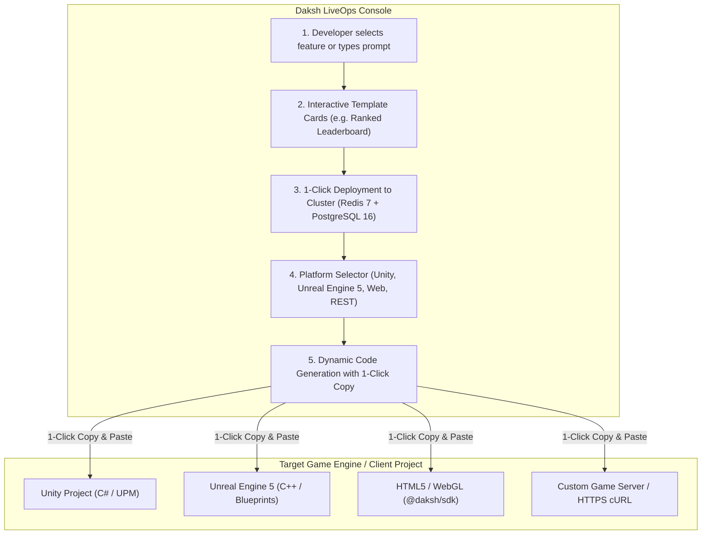
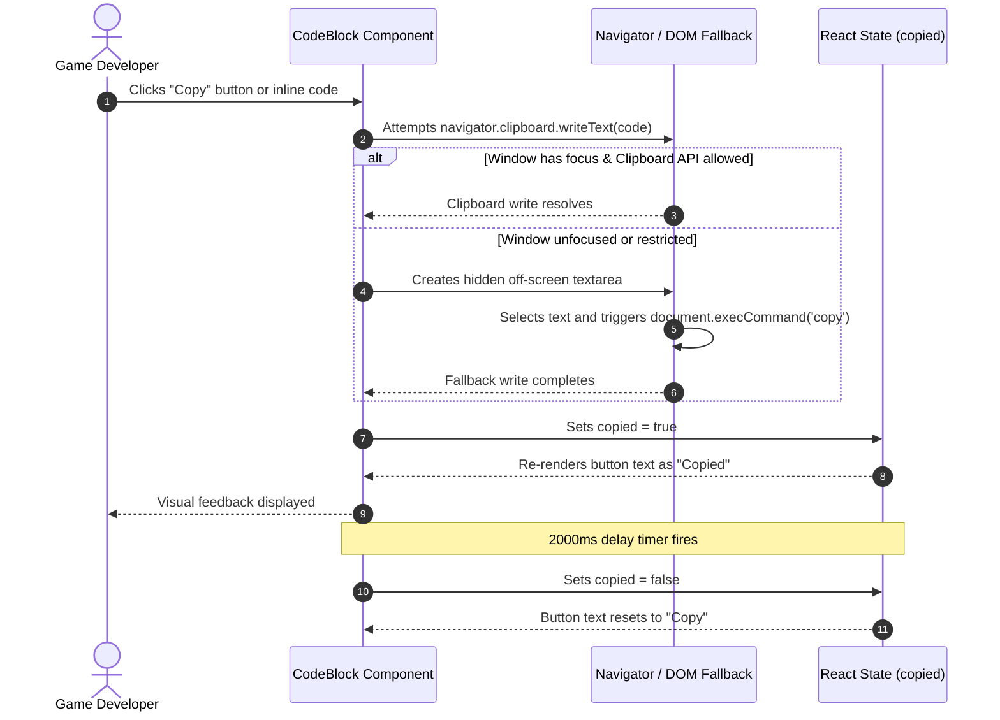

# Daksh Multi-Platform SDK Integration & 1-Click Copy Guide

This document explains the end-to-end architecture, developer workflow, and implementation details for integrating Daksh BaaS into game clients across Unity, Unreal Engine 5, HTML5/Web, and HTTPS REST APIs, as well as the interactive 1-click copy system in the LiveOps Console.

---

## 1. System Architecture & Workflow

When a game developer configures a backend feature (such as Leaderboards, Economy, or Matchmaking) through the Daksh LiveOps Console, the platform orchestrates microservices via MCP (Model Context Protocol) and generates tailored client-side integration code.



---

## 2. Supported Platforms & 3-Step Setup

Every feature generated by Daksh provides an exact 3-step setup tailored to the developer's game engine:

### A. Unity (C#)

The Unity SDK is packaged as a standard Unity Package Manager (UPM) git dependency located in `packages/sdk/unity/`.

#### Step 1: Install Package
In Unity Editor, navigate to **Window > Package Manager**, click the **+** button, select **Add package from git URL...**, and paste:
```bash
https://github.com/ingeniidigital-hue/daksh.git?path=packages/sdk/unity
```

#### Step 2: Initialize in Game (Bootstrap)
Attach a script to an active GameObject in your bootstrap scene:
```csharp
using UnityEngine;
using Daksh.SDK;

public class GameBootstrap : MonoBehaviour
{
    private void Awake()
    {
        DakshClient.Initialize(new DakshConfig
        {
            titleId = "TITLE_ID",
            serverUrl = "http://localhost:3000",
            offlineQueueEnabled = true
        });
    }
}
```

#### Step 3: Call Feature in Game Loop
Submit player scores or query top standings asynchronously:
```csharp
var client = DakshClient.Instance;

// Submit score
await client.Leaderboards.SubmitScoreAsync("LEADERBOARD_ID", playerRating);

// Fetch top 10 standings
var topRanks = await client.Leaderboards.GetTopScoresAsync("LEADERBOARD_ID", 10);
foreach (var entry in topRanks.records)
{
    Debug.Log($"Rank #{entry.rank}: {entry.username} - {entry.score}");
}
```

---

### B. Unreal Engine 5 (C++ & Blueprints)

The Unreal SDK is packaged as an Unreal Engine 5 plugin in `packages/sdk/unreal/`.

#### Step 1: Install Plugin
1. Copy the `packages/sdk/unreal` directory into your project's `Plugins/Daksh` folder.
2. In your project's `*.Build.cs` file, add `"DakshSDK"` to `PublicDependencyModuleNames`:
```csharp
PublicDependencyModuleNames.AddRange(new string[] { "Core", "CoreUObject", "Engine", "InputCore", "DakshSDK" });
```

#### Step 2: Initialize in Game (C++ Subsystem)
Access the subsystem from your GameInstance or PlayerController:
```cpp
#include "DakshClient.h"

UDakshClient* Daksh = GetGameInstance()->GetSubsystem<UDakshClient>();
Daksh->Initialize(TEXT("TITLE_ID"), TEXT("http://localhost:3000"));
```

#### Step 3: Call Feature (C++ or Blueprints)
Both C++ methods and Blueprint nodes are supported:
```cpp
// C++ Call
Daksh->SubmitScore(TEXT("TITLE_ID"), TEXT("LEADERBOARD_ID"), PlayerScore,
    FDakshScoreResponse::CreateLambda([](bool bSuccess, int32 NewRank) {
        UE_LOG(LogTemp, Log, TEXT("Score recorded. Current Rank: %d"), NewRank);
    })
);

// Blueprint Node
// Drag from UDakshClient -> "Submit Score" or "Get Top Standings"
```

---

### C. HTML5 / Web (JavaScript & TypeScript)

The Web SDK is available as an npm package in `packages/sdk/`.

#### Step 1: Install Package
```bash
npm install @daksh/sdk
```

#### Step 2: Initialize Client
```javascript
import { DakshLeaderboardClient } from "@daksh/sdk";

const daksh = new DakshLeaderboardClient("http://localhost:3000");
```

#### Step 3: Call Feature
```javascript
// Submit player score
await daksh.submitScore("TITLE_ID", "LEADERBOARD_ID", {
  playerId: "Player_01",
  score: 2850
});

// Fetch top 10 standings
const standings = await daksh.getTopScores("TITLE_ID", "LEADERBOARD_ID", 10);
console.log("Top Ranks:", standings.records);
```

---

### D. HTTPS / Raw REST API

For custom engines, dedicated servers, or game engines not listed above, direct HTTPS REST endpoints are available:

#### Step 1: Submit Score
```bash
curl -X POST "http://localhost:3000/api/titles/TITLE_ID/leaderboards/LEADERBOARD_ID/scores" \
  -H "Content-Type: application/json" \
  -d '{"playerId": "Player_01", "score": 2850}'
```

#### Step 2: Fetch Top Standings
```bash
curl -X GET "http://localhost:3000/api/titles/TITLE_ID/leaderboards/LEADERBOARD_ID/scores?limit=10"
```

---

## 3. The 1-Click Copy-Paste Architecture

To eliminate developer friction, every generated code block and inline identifier includes a unified copy mechanism.



### Key Implementation Details

1. **Dual-Layer Clipboard Writing**:
   - Primary: `navigator.clipboard.writeText(text)` (modern asynchronous API).
   - Fallback: Off-screen `<textarea>` with `document.execCommand('copy')` (ensures reliability across headless test harnesses, iframe sandboxes, and older browser environments).

2. **Transient State Feedback**:
   - `copied` boolean state switches the button label from `Copy` to `Copied` immediately upon click.
   - An automatic 2-second timeout resets the state back to `Copy`.

3. **Inline Quick-Copy**:
   - Inline code elements (e.g. Git URLs, leaderboard IDs, secret keys) can be clicked directly to copy, displaying an unobtrusive `copied` confirmation tag.

4. **Zero-Distraction Typography**:
   - Emotes and decorative icons have been excluded in favor of clean text badges and high-contrast developer containers.
