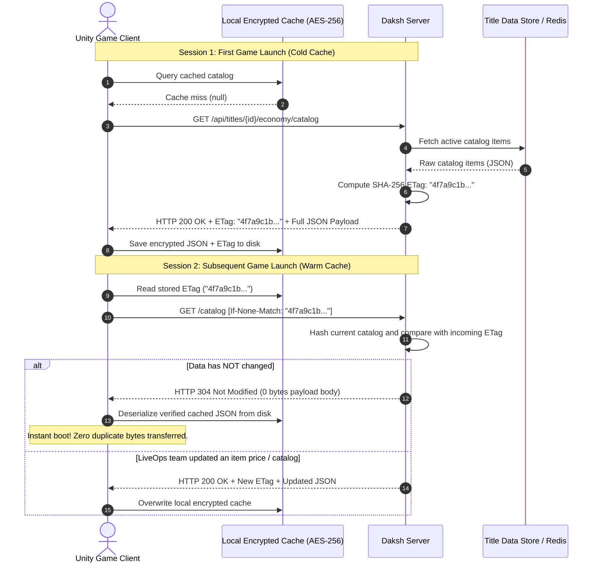
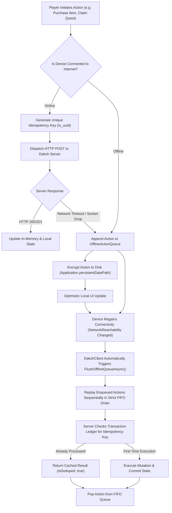

# Data Versioning, Caching & Sync Architecture

This guide explains how **Daksh Game BaaS** and the **Daksh Unity SDK** handle data versioning, offline persistence, network diffing, and synchronization.

---

## 1. Two-Tiered Data Taxonomy

Game state falls into two fundamental categories with different synchronization semantics:

| Dimension | Static / Title Data | Dynamic / Player Data |
| :--- | :--- | :--- |
| **Examples** | Item Catalogs, Drop Tables, LiveOps Remote Config, Game Balance Rules | Inventory, Currencies, Quests, Cloud Save, Match Results |
| **Authority** | Server-Authoritative (Studio publishes changes) | Client-Initiated, Server-Reconciled |
| **Read/Write Ratio** | Read-Heavy (Millions of reads, infrequent writes) | Write-Heavy (High-frequency state mutations) |
| **Sync Protocol** | HTTP 304 Conditional Validation via SHA-256 ETags | Optimistic Concurrency Control (OCC) + Idempotency Keys |
| **Offline Behavior** | Read from local AES-256 encrypted cache | Write to persistent FIFO disk queue for later replay |

---

## 2. Static Title Data & Catalogs: HTTP 304 ETag Diffing

Downloading large item catalogs on every game boot wastes cellular bandwidth and introduces login latency. Daksh solves this using **HTTP 304 Conditional Diffing**:



### Technical Details:
- **Server Implementation**: The server computes a SHA-256 hash across the serialized JSON body.
- **Client Implementation (`ETagStore.cs`)**: Caches both the payload and the server's `ETag`. When querying, `DakshClient` automatically attaches the `If-None-Match: "<etag>"` request header.
- **Offline Fallback**: If the network is entirely unreachable, `DakshClient.GetAsync<T>` catches the failure and automatically falls back to the local cached payload.

---

## 3. Dynamic Player Data & Mutations: Offline Queue & Idempotency

When players buy items, consume potions, or unlock levels on an unstable connection or in airplane mode, the SDK queues mutations to disk and guarantees idempotent server reconciliation.



### 3.1. Idempotency Keys (`X-Idempotency-Key`)
To prevent duplicate execution on network retry (e.g., deducting currency twice):
1. The client generates an idempotency key prior to dispatching the request:
   ```csharp
   string idempotencyKey = $"tx_{Guid.NewGuid():N}";
   ```
2. The server records this key in its transactional ledger.
3. If the client retries an interrupted request, the server detects the duplicate key and returns the original transaction outcome with `isDeduped: true`, preventing double-charging.

### 3.2. Optimistic Concurrency Control (OCC)
Player profile and save documents carry a monotonic `revision` counter:
```json
{
  "playerId": "usr_99812",
  "revision": 12,
  "saveData": { "checkpoint": "Dungeon_03", "xp": 4500 }
}
```
- Client sends `expectedRevision: 12` along with mutations.
- If the server has already progressed to revision 13 (e.g. another device updated the account), the write is rejected with `HTTP 409 Conflict`, invoking the game's conflict resolver.

---

## 4. Conflict Resolution Strategies

When offline client state diverges from cloud state, Daksh supports three resolution patterns:

```
                      ┌────────────────────────────────────────┐
                      │      Conflict Resolution Patterns      │
                      └──────────────────┬─────────────────────┘
                                         │
         ┌───────────────────────────────┼───────────────────────────────┐
         ▼                               ▼                               ▼
┌──────────────────┐           ┌──────────────────┐           ┌──────────────────┐
│ Server-Authoritative │         │  Last-Write-Wins  │         │ Delta Accumulator│
│ (Currencies, IAPs)│         │ (Settings, Audio)│         │ (XP, Playtime)   │
└──────────────────┘           └──────────────────┘           └──────────────────┘
```

1. **Server-Authoritative (Default for Economy & Progression)**:
   - The cloud database is the single source of truth.
   - When offline actions replay, the server validates current wallet balances and rejects invalid transactions (`INSUFFICIENT_FUNDS`).
2. **Last-Write-Wins (LWW) (Preferences & Audio)**:
   - Compares timestamps (`updatedAt`). The client with the most recent Unix millisecond timestamp overwrites earlier values.
3. **Delta Accumulation (Additive Counters)**:
   - Instead of sending absolute totals (`xp = 5000`), the client sends relative deltas (`deltaXp = +250`).
   - The server applies atomic increments (`HINCRBY`), completely avoiding race-condition overwrites across multiple sessions.

---

## 5. Unity SDK Code Examples

### 5.1. Utilizing ETag Caching
```csharp
// First call downloads and caches catalog ETag
var catalog = await DakshClient.Instance.Economy.GetCatalogAsync();

// Subsequent calls automatically attach 'If-None-Match'
// Receives HTTP 304 and returns cached data with 0 duplicate network payload
var cachedCatalog = await DakshClient.Instance.Economy.GetCatalogAsync();
```

### 5.2. Enqueuing Mutations Offline
```csharp
// Purchases automatically queue if offline when queueIfOffline is true
var purchaseResult = await DakshClient.Instance.Economy.PurchaseItemAsync(
    itemId: "steel_shield",
    currencyCode: "GOLD",
    customIdempotencyKey: $"tx_buy_{Guid.NewGuid():N}",
    queueIfOffline: true
);
```

### 5.3. Manual Queue Management
```csharp
// Inspect pending offline actions
int pendingCount = DakshClient.Instance.OfflineQueue.Count;
Debug.Log($"Pending offline actions: {pendingCount}");

// Manually trigger flush (automatically occurs on network reconnect)
int replayedCount = await DakshClient.Instance.FlushOfflineQueueAsync();
Debug.Log($"Flushed {replayedCount} offline mutations.");
```

---

## 6. Zero-Trust Architecture: Why Clients NEVER Set State

> [!CAUTION]
> **The #1 Fatal Exploit Vector in Mobile & Multiplayer Games:**
> Naive backends that expose client-writable state APIs (e.g. `SetGold(amount)`, `SetInventory(items)`, `SetScore(score)`) can be trivially compromised. Attackers use memory scanners (GameGuardian, CheatEngine), dynamic instrumentation (Frida), or MITM proxies (Burp Suite, Charles) to forge payloads like `{ gold: 999999 }` or `{ score: 99999999 }`.

### 6.1. The Principle of Server-Authoritative Action Reporting

In **Daksh Game BaaS**, **clients NEVER set values directly**. There is no endpoint that accepts arbitrary balance modifications or inventory assignments from a game client.

Instead, the client operates exclusively through **Action Intent Reporting**:
1. **The Client Reports What Happened**: "Player completed Dungeon X in Y seconds with Z monsters defeated."
2. **The Server Validates the Action**: The server executes anti-cheat rules (e.g. verifies completion duration exceeds theoretical minimum, checks match token, checks energy limits).
3. **The Server Autonomously Calculates Rewards**: The server determines the XP formula, rolls server-side drop tables, and credits the wallet directly in the database.
4. **The Server Signs & Dispatches the Delta**: The server returns an authoritative receipt with cryptographic HMAC proof and state deltas (`{ grantedRewards: { gold: 150, xp: 300 }, newBalances: { GOLD: 1250 } }`).

```mermaid
sequenceDiagram
    autonumber
    actor Player as Untrusted Game Client
    participant Server as Daksh Server
    participant Rules as Anti-Cheat & Rule Engine
    participant DB as Authoritative Ledger (Postgres/Redis)

    Note over Player,DB: The Client ONLY reports the event; never the reward!
    Player->>Server: POST /api/titles/{id}/actions/report<br/>{ actionType: "DUNGEON_CLEARED", context: { duration: 142s, monsters: 28 } }
    
    Server->>Rules: Validate Preconditions & Anti-Cheat Rules
    alt Exploit Detected (e.g. Cleared 10-minute dungeon in 2 seconds)
        Rules-->>Server: Flag Exploit: Impossible completion duration
        Server-->>Player: HTTP 403 Forbidden { antiCheatFlagged: true, error: "EXPLOIT_DETECTED" }
        Note over Server: Security Alert logged, player flagged for ban
    else Action Verified
        Rules-->>Server: Valid
        Server->>Server: Calculate authoritative rewards (Gold formula, XP, Loot tables)
        Server->>DB: Atomically credit player wallet and add inventory item
        DB-->>Server: Updated state committed
        Server->>Server: Sign outcome with server HMAC secret
        Server-->>Player: HTTP 200 OK<br/>{ success: true, grantedRewards: { gold: 150, xp: 300 }, newBalances: { GOLD: 1250 } }
        Player->>Player: Update local UI to mirror authoritative server delta
    end
```

### 6.2. Comparison: Naive vs. Daksh Zero-Trust Model

| Operation | Naive Vulnerable SDK (Insecure) | Daksh Zero-Trust SDK (Secure) |
| :--- | :--- | :--- |
| **Defeating a Boss** | Client calls: `SetGold(currentGold + 500)` *(Attacker changes 500 to 5,000,000)* | Client calls: `Actions.ReportActionAsync("BOSS_DEFEATED", context)` *(Server verifies boss encounter and calculates rewards)* |
| **Purchasing an Item** | Client passes price: `BuyItem(id: "sword", price: 100)` *(Attacker passes price: 0)* | Client passes item ID: `PurchaseItemAsync("sword")` *(Server looks up authoritative catalog price and debits wallet)* |
| **Loot Boxes** | Client rolls RNG locally and requests: `GrantItem("legendary_dragon_armor")` | Client requests: `TitleData.RollLootDrop("chest_01")` *(Server rolls cryptographically on backend using secret weights)* |
| **High Scores** | Client submits raw score: `SubmitScore(999999)` without proof | Server validates `maxScoreDelta` rate limiter and verifies match token before accepting score |

### 6.3. Unity C# Action Reporting Example

```csharp
using Daksh.SDK;
using UnityEngine;

public class DungeonManager : MonoBehaviour
{
    public async void OnDungeonFinished(string dungeonId, float elapsedSeconds, int killCount)
    {
        Debug.Log("Reporting dungeon completion event to Daksh server...");

        // 1. Client reports ONLY the action event — NEVER sets the reward!
        var result = await DakshClient.Instance.Actions.ReportActionAsync("DUNGEON_CLEARED");

        if (result != null)
        {
            if (result.antiCheatFlagged)
            {
                Debug.LogError($"Anti-cheat flagged action: {result.error}");
                return;
            }

            if (result.success)
            {
                // 2. Server authoritatively decided rewards
                int goldAwarded = result.grantedRewards.gold;
                int xpAwarded = result.grantedRewards.xp;
                Debug.Log($"Server granted: +{goldAwarded} Gold, +{xpAwarded} XP! New Balance: {result.newBalances}");

                // 3. Update local render state to reflect authoritative server delta
                UpdatePlayerHUD(goldAwarded, xpAwarded);
            }
        }
    }
}
```

